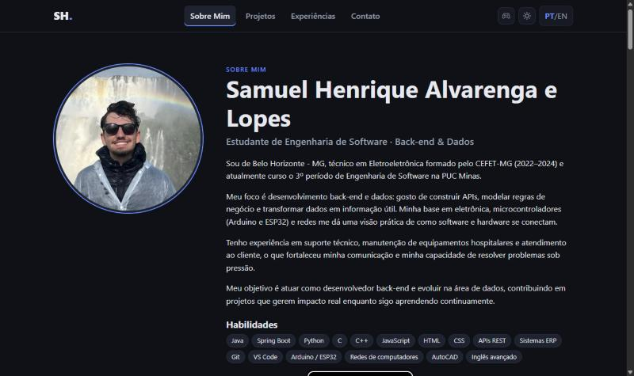
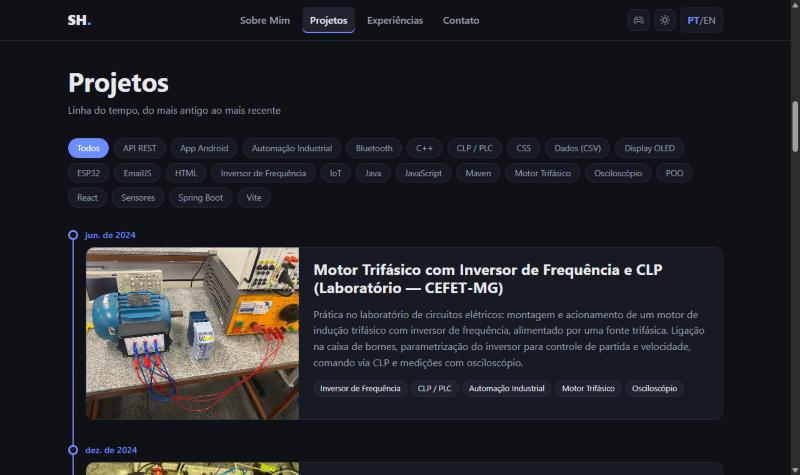
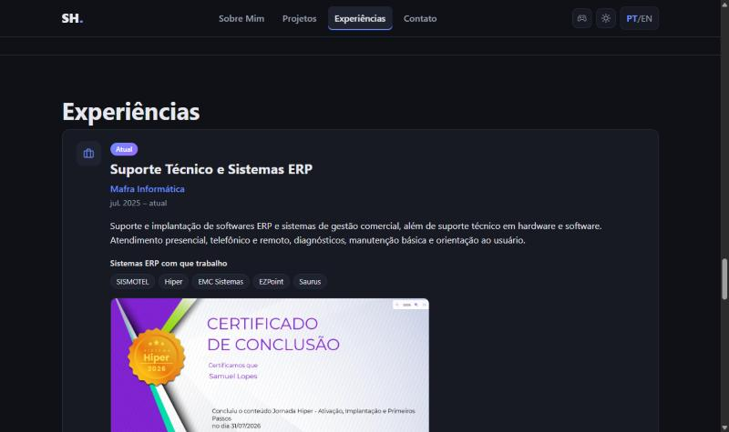
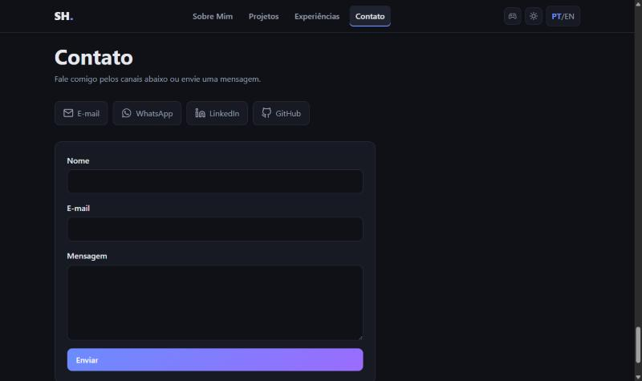

# 💼 Portfólio Profissional — Samuel Henrique

Site de portfólio pessoal desenvolvido no **Laboratório 01** da disciplina **DIAW** — Engenharia de Software, PUC Minas.

🌐 **Acesse:** [samuelhenrique.vercel.app](https://samuelhenrique.vercel.app)

  

---

## 📸 Telas

| Sobre Mim | Projetos |
| :---: | :---: |
|  |  |
| **Experiências** | **Contato** |
|  |  |

<!-- 🎨 Protótipos (Figma): adicionar o link e as imagens dos wireframes aqui. -->

---

## ✨ Funcionalidades

- **Sobre Mim** — apresentação em português e inglês, foto e habilidades.
- **Projetos** — linha do tempo (do mais antigo ao mais recente) com imagem, tecnologias e link do GitHub.
- **Experiências** — empresa, cargo, período e descrição.
- **Contato** — ícones de e-mail, WhatsApp, LinkedIn e GitHub + formulário que envia e-mail.
- **Extras** — modo claro/escuro, site responsivo, terminal interativo, estatísticas do GitHub, jogo do Pac-Man 🎮 e "Modo Galo" 🐓 (cena 3D e jogos do Atlético-MG).

---

## 🛠 Tecnologias e dependências

| Tecnologia | Para que serve |
| :--- | :--- |
| **React 19** + **Vite 8** | Construção da interface e build |
| **JavaScript** e **CSS** | Lógica e estilo (CSS puro, responsivo) |
| `@emailjs/browser` | Envio do formulário de contato por e-mail |
| `framer-motion` | Animações |
| `react-icons` | Ícones |
| `three` | Cena 3D do Modo Galo |
| **Vercel** | Hospedagem gratuita na nuvem |

Não há back-end próprio: o e-mail é enviado pelo serviço **EmailJS** direto do navegador.

---

## 📂 Estrutura de pastas

```
├── public/            # Foto, currículo e imagens dos projetos
├── docs/telas/        # Prints usados neste README
├── src/
│   ├── data/          # Conteúdo do site (portfolio.js) e textos PT/EN (i18n.js)
│   ├── pages/         # Seções: Sobre Mim, Projetos, Experiências, Contato
│   ├── components/    # Cabeçalho, rodapé, terminal, jogo, cena 3D...
│   ├── context/       # Idioma e tema (claro/escuro)
│   ├── game/          # Pac-Man
│   ├── galo3d/        # Cena 3D (Three.js)
│   ├── services/      # Busca dos jogos do Atlético-MG
│   ├── App.jsx        # Monta a página
│   └── index.css      # Estilos
├── .env.example       # Modelo das chaves do EmailJS
└── package.json       # Dependências e scripts
```

> Para atualizar o conteúdo do site, basta editar **`src/data/portfolio.js`**.

---

## ▶️ Como rodar localmente

Pré-requisito: **Node.js 20+**

```bash
git clone https://github.com/samuelhenriqueALopes/Portifolio.git
cd Portifolio
npm install
npm run dev
```

Abra **http://localhost:5173**.

**Formulário de contato (opcional):** copie `.env.example` para `.env` e preencha com as chaves da sua conta no [EmailJS](https://www.emailjs.com/) — `VITE_EMAILJS_SERVICE_ID`, `VITE_EMAILJS_TEMPLATE_ID` e `VITE_EMAILJS_PUBLIC_KEY`.

---

## 🚀 Deploy

O site está na **Vercel**, conectado a este repositório: cada `git push` na branch `main` publica a nova versão automaticamente.

---

## 👤 Autor

**Samuel Henrique Alvarenga e Lopes** — [GitHub](https://github.com/samuelhenriqueALopes) · [LinkedIn](https://www.linkedin.com/in/samuel-lopes-423681334) · [E-mail](mailto:samuellopescefet@gmail.com)

Orientação: [Prof. Dr. João Paulo Aramuni](https://github.com/joaopauloaramuni) — PUC Minas
